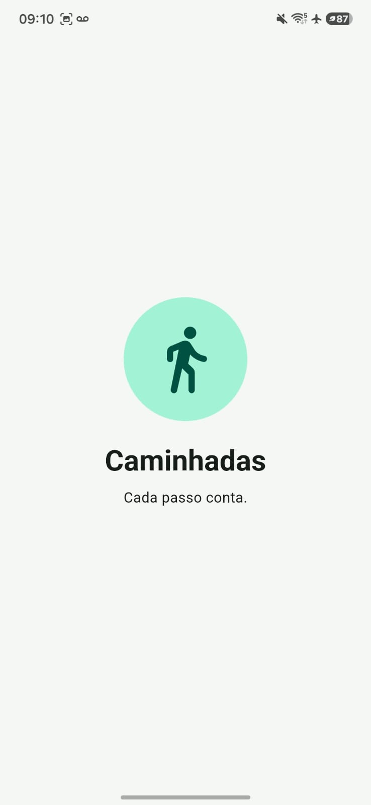
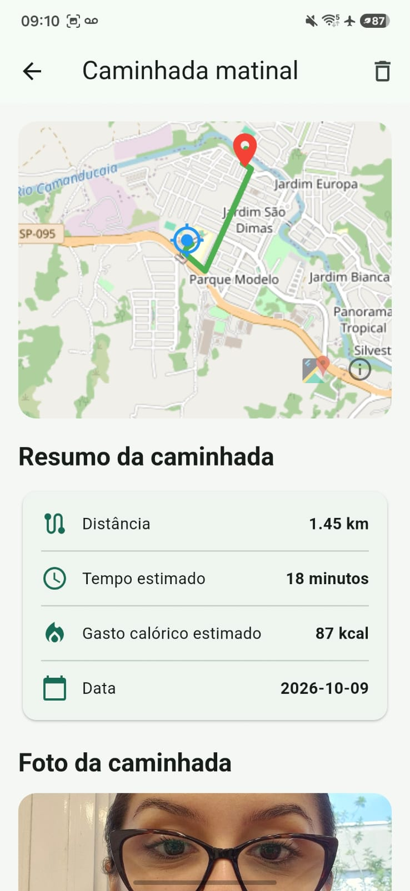
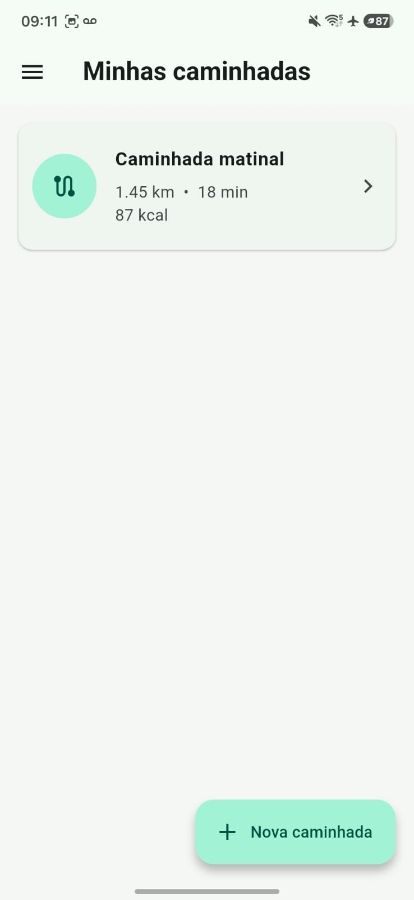

# App Caminhadas 🚶

Aplicativo mobile desenvolvido com Flutter para registrar caminhadas, visualizar rotas no mapa e acompanhar informações como distância, tempo estimado e calorias.

## 📱 Prints das telas

### Splash Screen



### Menu principal


### Caminhada



### Minhas caminhadas



## 🛠️ Tecnologias utilizadas

* Flutter e Dart
* OpenStreetMap
* flutter_map
* latlong2
* Geolocator
* HTTP
* SQLite (sqflite)
* image_picker
* path e path_provider
* shared_preferences

## ▶️ Como executar

**1. Clone o repositório:**

```bash
git clone https://github.com/CorreaLeticia/flutter_app_caminhadas.git
```

**2. Acesse a pasta do projeto:**

```bash
cd flutter_app_caminhadas
```

**3. Instale as dependências:**

```bash
flutter pub get
```

**4. Execute o aplicativo:**

```bash
flutter run
```

É necessário ter o Flutter SDK e o Android SDK configurados, além de um dispositivo Android conectado ou emulador iniciado.

## 📥 Download do APK

[**Clique aqui para baixar o aplicativo (.apk)**](https://github.com/CorreaLeticia/flutter_app_caminhadas/releases/latest)

## 👩‍💻 Desenvolvedora

Letícia Corrêa

Projeto acadêmico do curso Técnico em Desenvolvimento de Sistemas — SENAI.
